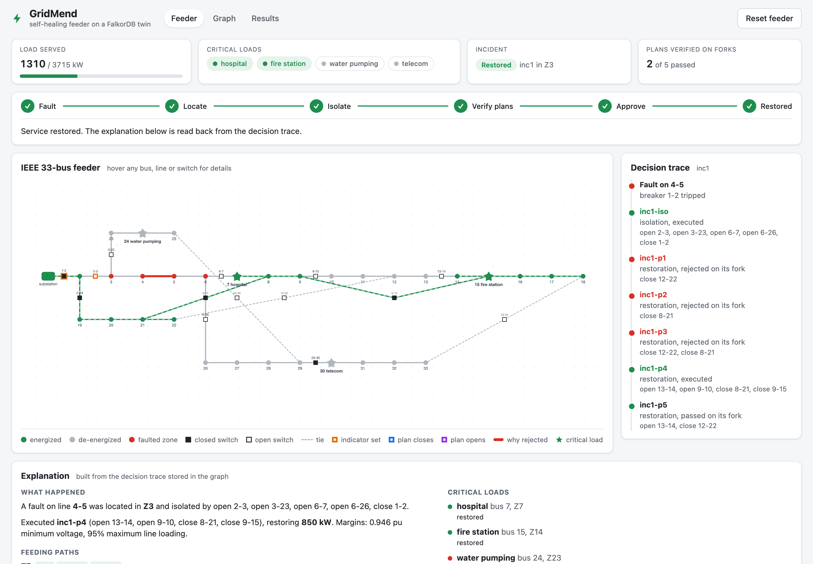
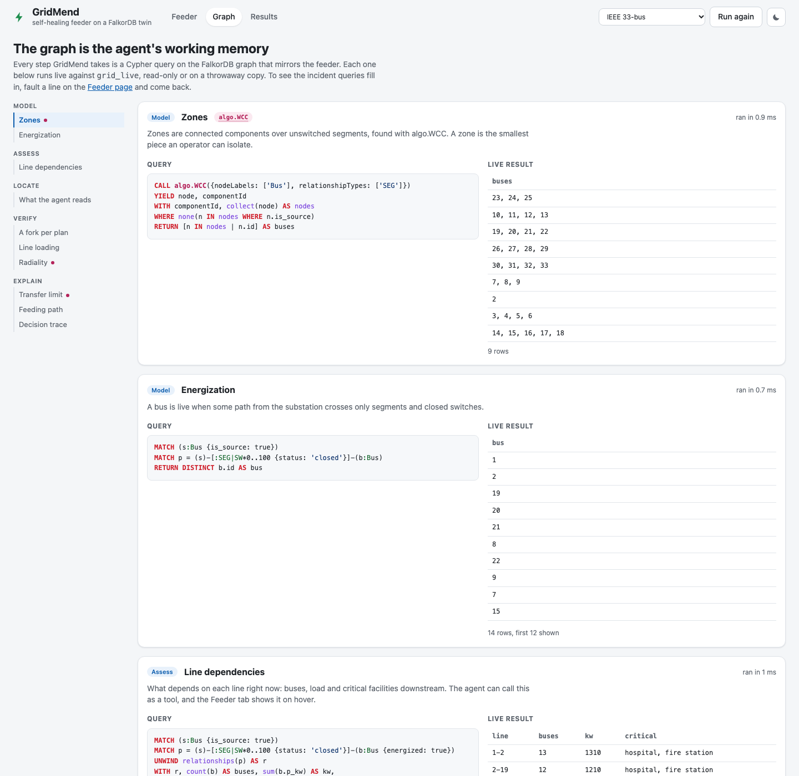
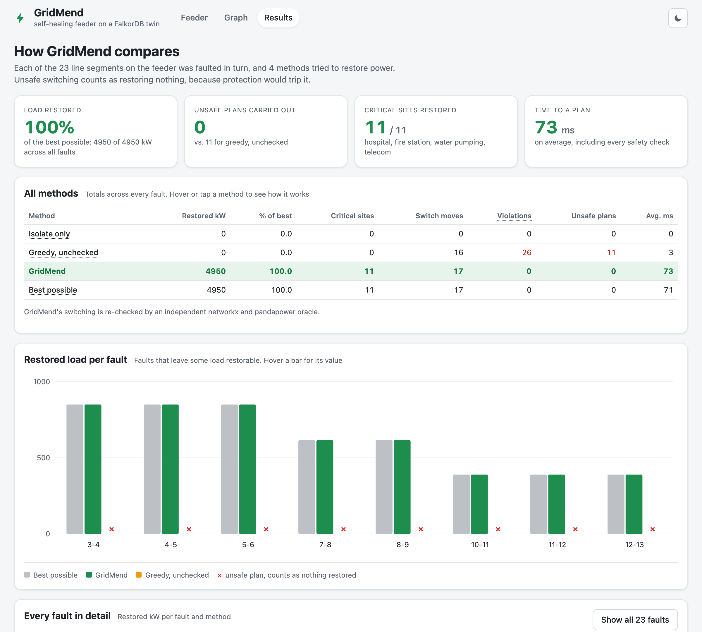
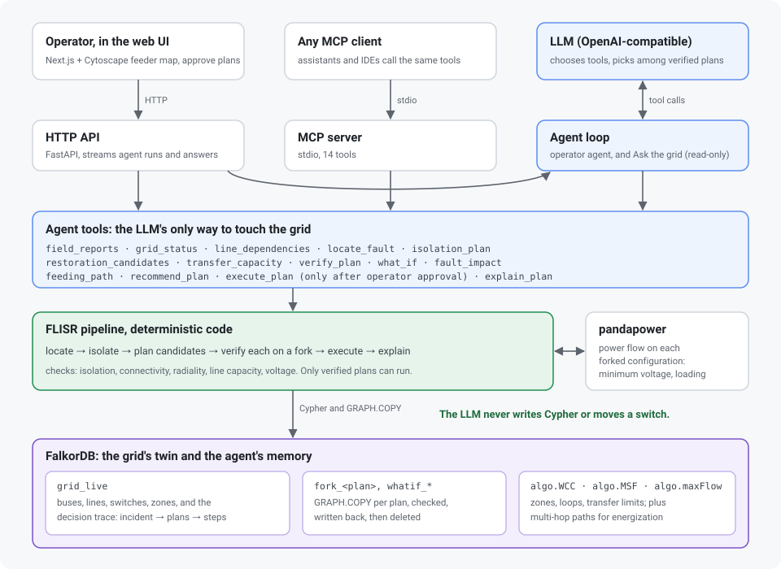

# GridMend: a self-healing grid agent on a FalkorDB twin

> **An LLM agent that locates, isolates and restores faults on its own, with 0 unsafe plans across
> all 23 single faults and 85% of the best possible restoration.** A language model planning alone,
> without the graph and the simulator, produced unsafe switching in 20 of 23.

GridMend is an LLM agent that restores power after a fault on a distribution feeder, working on
a digital twin of the feeder held in FalkorDB. The agent does the operator's thinking: it reads
the fault-indicator readings and decides where the fault is, writes the switching that isolates
it, and designs how to re-feed the healthy areas, revising each design when the twin shows it
would close a loop, overload a line or drop voltage. Nothing deterministic decides for it. What
stands between the model and the real switches is physics and an interlock: every plan it writes
is applied to a forked copy of the graph and checked there, only plans that pass can move a live
switch, and if it misreads the indicators, reclosing onto the fault trips the breaker again and
it has to think again. Every decision is written back into the graph, so any restoration can be
explained afterwards, path by path.

It also acts on what people tell it in plain words. A field crew reports a jammed switch, and the
agent isolates and restores around it. And it answers questions: **Ask the grid** takes "which
line is most critical right now?" or "how is the hospital fed?", lets the LLM chain read-only
graph tools to find out, answers with the evidence and the tools it used, and highlights the
path or lines it relied on on the map.

**Track:** 01, Agents That Act on Connected Data.

**Try it:**

* **Run the published image** (full speed, needs only Docker), then open http://localhost:7860:

  ```bash
  docker run --rm -p 7860:7860 ghcr.io/anish891/gridmend
  ```

* **Live demo:** https://gridmend.onrender.com. It runs on Render's free tier (0.1 CPU) and sleeps
  when idle, so the first visit takes about half a minute to wake it. The agent then takes a
  minute or two per fault.

Use the **network switch** in the top bar to move between the IEEE 33-bus test feeder and a real
177-bus, two-substation 20 kV network (Oberrhein). Then **build what goes wrong**: click up to
three lines on the map to fault them and any switches to make them jam, and trip the feeder, or
start from a known incident such as a fault hidden behind another. Next to the map, **Agent
decisions** fills in as the agent works: the indicators it read and the zone it declared, the
isolation it tested and whether the breaker held, every restoration design it tried with the
reason it failed or passed, and the plan it recommends, followed by its briefing. Approve the
plan it recommends (or another that passed). The same side panel holds **Ask the grid** and the
**Crew report**. After the main-line fault is restored, **Reconnect the solar plant** brings the
500 kW plant on the 19-22 lateral back online and the agent plans a second stage. Switch the map
to **Risk map** to see every line coloured by what a fault there would leave dark. The **Graph**
tab shows the live Cypher behind every tool and what it returns right now.



## The problem

A feeder carries power from a substation to homes, hospitals and businesses. When a line
faults, the breaker at the substation trips and everyone downstream goes dark, not only the
customers near the fault. Operators must then:

1. find which section faulted,
2. cut it out by opening switches,
3. re-feed the healthy sections through normally open tie switches,

without creating loops, overloading lines or letting voltage sag below safe limits. Utilities
call this FLISR (fault location, isolation and service restoration). It normally lives inside
expensive distribution-management systems, and its decisions are hard to inspect. The state
of the field arrives as crew notes, not as clean data.

## What GridMend does

| Step | Who decides | What the graph provides |
|---|---|---|
| Locate | The agent reads every switch's fault indicator and the zones it joins, and declares the faulted zone with its evidence | `zone_map`: switches, indicator states and the zones on each side |
| Isolate | The agent writes the switching that cuts the zone out and recloses the breaker, working around jammed switches | A fork to simulate it on; protection on the live twin trips again if power reaches the fault |
| Restore | The agent designs which ties to close and which sectionalizers to open, and revises against each failed check | Zones, loads, critical sites and switch ratings; `transfer_capacity` (max flow) for the upper bound |
| Simulate | Code applies every plan to `GRAPH.COPY` of the live graph: operability, isolation, connectivity, radiality, capacity, voltage | A fork per plan; power flow on the forked configuration |
| Act | The interlock: only plans that passed simulation move live switches; restoration waits for the operator's approval | `Plan.status` is `verified` |
| Explain | The agent explains; the graph keeps feeding paths, margins, rejected designs, the evidence it read and a numbered switching order | Stored decision trace |

The LLM never writes Cypher and never flips a switch directly: it calls thirteen tools that read
the twin, simulate on forks and execute plans that passed. Simulation and protection are physics,
not rules: they say what the switching would do, never what to do. As a reader it also turns crew
notes into structured values that code validates before writing.

### Example: fault on line 4-5 (zone Z3)

From a live run with `openai.gpt-oss-120b` on Amazon Bedrock:

* The breaker trips and all 33 buses go dark. The agent reads the indicators: 1-2 and 2-3 set,
  everything beyond clear, so it declares Z3.
* It writes the isolation (open 2-3, 3-23, 6-7 and 6-26, close 1-2), simulates it, and executes
  it: Z2 and Z19 come back.
* It designs restoration and revises on the twin's answers:
  * close 8-21 alone: rejected, line 2-19 would carry 1584 kVA of 1400 (113%);
  * open 13-14, close 8-21: passes, but leaves the fire station dark;
  * open 9-10 and 13-14, close 8-21 and 9-15: **passes**, feeding the hospital (Z7) and the fire
    station (Z14) over two ties at 95% loading and 0.946 pu.
* It recommends the plan with both critical sites; water pumping stays dark (no tie reaches a
  live zone) and so does telecom (the path through 2-19 has no capacity left).

If the agent misreads the indicators and isolates the wrong zone, its simulation still passes
(the fork knows only its diagnosis), but executing it recloses onto the real fault: the breaker
trips again, the indicators change, and the agent has to locate again. The same happens, by
design, with a second fault hidden upstream of the first.

## What the LLM does, and what it does not

* **Operator agent.** It handles the incident end to end. It decides which tools to call and in
  what order, reads the indicators and declares the fault (`declare_fault`), writes the isolation
  and restoration switching and tests each with `simulate_plan`, reads the violations (a loop, an
  overload on 2-19 with its loading, buses below 0.90 pu, a jammed switch) and revises. It
  chooses among plans that passed (most critical sites restored, then most load, then fewest
  switch operations) and explains the choice. On the command line it executes with your
  approval; in the web UI it isolates on its own and recommends the restoration, and you
  approve it.
* **Crew-note reader.** From a crew's free-text note it lists the switches the note says are
  jammed or repaired, with the evidence. Code accepts a finding only if the switch exists, the
  evidence is quoted from the note itself, and any position the note states matches the twin.

It never writes Cypher, never moves a switch except through a plan that passed simulation, and
never decides whether a plan is safe: the fork does. The evaluation's `llm-only` row shows what
happens when a model plans without the graph and the simulator.

## Why FalkorDB is load-bearing

Remove FalkorDB and nothing is left: no twin, no forks, no paths, no trace.

* **Zones** are connected components over unswitched segments (`algo.WCC` filtered to `SEG`).
* **Energization** is reachability from the substation over segments and closed switches.
* **The agent's view** (`zone_map`) is one query over switches, their indicators and the zones
  on each side: the evidence it locates from and the map it designs on.
* **Protection** is a traversal on the live twin: if any faulted segment is energized after a
  switching, the breaker on the path trips and the indicators along it are set again.
* **Line dependencies** come from the same traversal: for every line, the buses, load and
  critical facilities downstream of it right now.
* **Line loading** is computed in one query: every energized bus has exactly one path from the
  source in a radial feeder, so a line carries the load of the buses whose path uses it.
* **Radiality** is a minimum spanning forest (`algo.MSF`) on the conducting edges of a fork: any
  conducting edge the tree cannot use closes a loop, and that tie is named.
* **Transfer limit** is `algo.maxFlow` from the substation to every healthy load: the most any
  switching could restore, and the lines that cap it.
* **Safety** comes from a forked graph per plan (`GRAPH.COPY`), checked before any switch moves.
* **Explainability** comes from the decision trace stored next to the grid: incidents with the
  agent's evidence, every plan it simulated, switch operations, violations, the zones each plan
  restores, and the crew reports it took into account.

## Graph data model

Graphs: `grid_base` (pristine feeder, used for reset), `grid_live` (current state and decision
trace) and `fork_<planId>` (temporary, deleted after simulation).

```
(:Bus {id, pp_index, p_kw, q_kvar, s_kva, critical, facility, weight, zone, energized, is_source})
(:Zone {id, p_kw, weighted_kw, energized, faulted, cut_off})

(:Bus)-[:SEG {id, r_ohm, x_ohm, cap_kva, faulted}]->(:Bus)                 unswitched line
(:Bus)-[:SW {id, kind, status, normally, r_ohm, x_ohm, cap_kva, fi, operable, report}]->(:Bus)
        kind: breaker | sectionalizer | tie     status: open | closed     fi: set | clear | none
(:Bus)-[:IN_ZONE]->(:Zone)
(:Zone)-[:BOUNDARY {switch_id, kind}]->(:Zone)                            upstream -> downstream

(:CrewReport {id, note, other, model, ts})-[:FINDS]->(:Finding {switch_id, operable, evidence})

(:Incident {id, ts, fault_line, status, evidence})-[:FAULT_IN]->(:Zone)   evidence: the agent's reading
(:Incident)-[:HAS_REPORT]->(:CrewReport)
(:Incident)-[:CUTS_OFF {via}]->(:Zone)                    healthy zone isolated with the fault
(:Incident)-[:HAS_PLAN]->(:Plan {id, kind, status, origin, switch_ops, restored_kw, restored_weighted,
                                 min_v_pu, max_loading_pct, recommended, recommendation})
        kind: isolation | restoration     status: verified | rejected | executed
        origin: agent | manual    (the agent, or an operator simulating by hand)
(:Plan)-[:STEP]->(:SwitchOp {seq, switch_id, op})
(:Plan)-[:VIOLATES]->(:Violation {type, detail})
(:Plan)-[:RESTORES]->(:Zone)
```

Indexes on `Bus.id`, `Zone.id`, `Plan.id` and `Incident.id`. Separate `SEG` and `SW` types keep
the two core queries simple: zones are components over `SEG` only, and energization is `SEG`
plus closed `SW`.

## The Cypher the product depends on



Zones: connected components over unswitched segments
([zones.py](backend/gridmend/grid/zones.py)).

```cypher
CALL algo.WCC({nodeLabels: ['Bus'], relationshipTypes: ['SEG']})
YIELD node, componentId
WITH componentId, collect(node) AS nodes
WHERE none(n IN nodes WHERE n.is_source)
RETURN [n IN nodes | n.id] AS buses
```

Energized buses: reachability through segments and closed switches
([energize.py](backend/gridmend/grid/energize.py)).

```cypher
MATCH (s:Bus {is_source: true})
MATCH p = (s)-[:SEG|SW*0..100 {status: 'closed'}]-(b:Bus)
RETURN DISTINCT b.id AS bus
```

What the agent reads: every switch with its state, indicator and the zones on each side
([zones.py](backend/gridmend/grid/zones.py)).

```cypher
MATCH (x:Bus)-[s:SW]->(y:Bus)-[:IN_ZONE]->(zb:Zone)
OPTIONAL MATCH (x)-[:IN_ZONE]->(za:Zone)
RETURN s.id, s.kind, s.status, s.operable, s.cap_kva, s.fi, za.id AS from_zone, zb.id AS to_zone
ORDER BY s.kind, s.id
```

Protection after a switching ([sim.py](backend/gridmend/sim.py)): any faulted segment with
power trips the breaker on its path from the source.

```cypher
MATCH (a:Bus {energized: true})-[:SEG {faulted: true}]->(:Bus)
RETURN a.id
```

Line loading on a fork: in a radial feeder each energized bus has one path from the source, so
summing the loads of the buses behind each edge, net of any solar online there, gives the edge's
flow
([verify.py](backend/gridmend/flisr/verify.py)).

```cypher
MATCH (s:Bus {is_source: true})
MATCH p = (s)-[:SEG|SW*0..100 {status: 'closed'}]-(b:Bus {energized: true})
UNWIND relationships(p) AS r
WITH r, sum(b.p_kw - CASE WHEN coalesce(b.dg_online, false) THEN b.dg_kw ELSE 0 END) AS p_kw, sum(b.q_kvar) AS q_kvar
RETURN r.id AS line, sqrt(p_kw * p_kw + q_kvar * q_kvar) AS kva, r.cap_kva AS rating_kva
```

Radiality on a fork that keeps only conducting edges: each substation's spanning tree covers the
buses it energizes, and any conducting edge a tree leaves out closes a loop. Ties weigh more, so
the loop is reported at the tie that closed it, and a tree that reaches two substations joins
them into one network.

```cypher
CALL algo.MSF({nodeLabels: ['Bus'], relationshipTypes: ['SEG', 'SW'],
               weightAttribute: 'tree_weight'})
YIELD nodes, edges
WITH nodes, [e IN edges | e.id] AS tree, [n IN nodes WHERE n.is_source | n.id] AS sources
WHERE size(sources) > 0
OPTIONAL MATCH (a:Bus)-[r:SEG|SW]->(:Bus)
WHERE a IN nodes AND NOT r.id IN tree
RETURN size(nodes) AS energized_buses, sources, collect(r.id) AS loop_edges
```

Forking is `GRAPH.COPY grid_live fork_<planId>`. The checks run on the fork, the outcome is
written to `grid_live` as a `Plan` with `STEP`, `VIOLATES` and `RESTORES` edges, and the fork is
deleted. An isolation plan is checked the same way; it claims no zones, only that the declared
faulted zones stay dark and everything it re-energizes is safe.

Transfer limit on a throwaway copy where every line is a pair of `FLOW` edges and every healthy
load drains into one sink ([transfer.py](backend/gridmend/flisr/transfer.py)).

```cypher
MATCH (s:Bus {is_source: true})
WITH collect(s) AS sources
MATCH (t:Sink)
CALL algo.maxFlow({sourceNodes: sources, targetNodes: [t], capacityProperty: 'cap_kva',
                   relationshipTypes: ['FLOW']})
YIELD edges, edgeFlows, maxFlow
RETURN maxFlow AS deliverable_kva,
       [i IN range(0, size(edges) - 1)
        WHERE edges[i].id IS NOT NULL AND edgeFlows[i] >= edges[i].cap_kva - 0.001
        | edges[i].id] AS saturated
```

Explanation: the feeding path of a restored zone
([explain.py](backend/gridmend/flisr/explain.py)).

```cypher
MATCH (s:Bus {is_source: true}), (t:Bus {id: $zone})
MATCH p = (s)-[:SEG|SW*0..100 {status: 'closed'}]-(t)
RETURN [r IN relationships(p) WHERE type(r) = 'SW' | r.id] AS switches
ORDER BY length(p)
LIMIT 1
```

## Evaluation

All 23 single faults on unswitched segments of the IEEE 33-bus feeder, five methods
(`gridmend eval --agent --llm-only`):

| method | restored kW | % of optimal | critical loads | switch ops | violations | unsafe plans | mean time ms |
|---|---:|---:|---:|---:|---:|---:|---:|
| isolate-only | 0 | 0.0 | 0 | 0 | 0 | 0 | 0 |
| greedy | 0 | 0.0 | 0 | 16 | 26 | 11 | 0 |
| llm-only | 1170 | 23.6 | 3 | 59 | 26 | 20 | 14883 |
| **agent** | **4230** | **85.5** | **8** | **13** | **0** | **0** | **22430** |
| optimal | 4950 | 100.0 | 11 | 17 | 0 | 0 | 64 |



* **agent** is GridMend: `openai.gpt-oss-120b` on Amazon Bedrock starts from the tripped breaker,
  reads the indicators, isolates, and designs and executes the restoration through the tools,
  with no deterministic planner. Its final configuration is re-checked by the oracle.
* **isolate-only**, **greedy** and **llm-only** start from a standard isolation (kept in
  [`eval/isolation.py`](backend/eval/isolation.py) for the baselines only). **greedy** closes the
  first tie into each dead zone without checking; **llm-only** gives `qwen/qwen3.8-27b` a text
  description of the isolated feeder and no tools, and its switching is executed unchecked.
* **optimal** is a brute-force oracle over every switch combination, written with networkx and
  pandapower only and never reading FalkorDB.

Unsafe switching is scored as restoring nothing, since protection would trip it. The agent
located and isolated every fault correctly on its own and never executed an unsafe plan; where it
falls short of the optimum (faults 3-4, 4-5 and 5-6), it settled for a safe plan that restores the
hospital but not the fire station, instead of finding the two-tie split that restores both. Its
time is the whole incident, from the tripped breaker to the executed restoration, through a
hosted model. Model-driven rows are not deterministic, so `gridmend eval --agent` and
`--llm-only` record their rows in [`agent.csv`](backend/eval/agent.csv) and
[`llm_only.csv`](backend/eval/llm_only.csv), and every later `gridmend eval`, including the image
build, replays them. The Results page also shows, as a faded bar, the load each unsafe plan
claimed it would restore.

### Scaling to a real network

The same code runs on pandapower's `mv_oberrhein`, a real 20 kV network: 177 buses, two 110/20
kV substations, four feeders, real cable ratings and six normally open points, three of them
between the substations. Remote-controlled sectionalizers are placed so zones hold about ten
buses (20 zones), and the largest load on each feeder stands in for a critical site
([`oberrhein.yaml`](backend/data/oberrhein.yaml)). It lives in its own graphs next to the 33-bus
twin, and the **network switch** in the top bar of the web UI moves between them: the real network
is drawn from its coordinates, with its own demo faults, Play the demo, Ask the grid, Results and
Graph pages. Every API call names its feeder (`?feeder=oberrhein`). From the command line:

```bash
export GRIDMEND_FEEDER=oberrhein
gridmend load                              # writes oberrhein_base and oberrhein_live
gridmend agent 13-19 --auto                # a fault trips only its own feeder's breaker
gridmend eval                              # baselines on every segment; backend/eval/out/oberrhein/
```

The agent works the real network through the same tools: zones and indicators come from the
graph exactly as on the 33-bus feeder, and the fork checks also catch a plan that would join the
two substations into one network. Running the agent over all 155 single faults would take hours
of model time, so the Oberrhein results page shows the baselines only; the brute-force oracle
handles one substation, so there is no optimum here either.

## Architecture



Where each part lives:

```
gridmend.grid   load, zones, energization (case data -> graph)
gridmend.flisr  declare (the agent's diagnosis), simulate (+ pandapower), interlocked execute,
                explain, trace, transfer (max flow), crew reports
gridmend.agent  13 tools --+-- LLM operator loop and Ask the grid (any OpenAI-compatible endpoint)
                           +-- MCP server (stdio)
gridmend.api    HTTP API --+-- Next.js + Cytoscape UI
eval            scenario runner, the agent row, baselines (with their own deterministic isolation
                and greedy switching), networkx/pandapower oracle
```

## Run it locally

Requirements: Docker, Python 3.11+ ([uv](https://docs.astral.sh/uv/) recommended), Node 20+.

```bash
docker compose up -d                       # FalkorDB on :6379, FalkorDB Browser on :3000
cp .env.example .env

cd backend
uv venv -p 3.12 .venv && source .venv/bin/activate
uv pip install -e '.[test]'
gridmend ping                              # OK
gridmend load                              # writes grid_base and grid_live
gridmend agent 4-5 --auto                  # the agent locates, isolates and restores
gridmend reset
gridmend agent 4-5 --auto                  # stage 1: hospital and fire station
gridmend dg --reconnect                    # solar on bus 21 returns once its zone has power
gridmend agent --auto                      # stage 2: the agent plans again on the same incident
gridmend reset
pytest                                     # 141 tests, on scratch graphs, with scripted models
gridmend eval                              # baselines + the recorded agent rows
gridmend eval --agent                      # run the agent on all 23 faults and record it
gridmend api                               # HTTP API on :8000

cd ../frontend
npm install
npm run dev                                # UI on http://localhost:3001
```

Other commands: `basecase`, `zones`, `status`, `switch <id> open|close`, `fault <line> [<line> ...]`,
`verify --close a,b --open c` (simulate a plan by hand), `mcp`, `eval --llm-only`,
`serve --ui <dir>`, and:

```bash
gridmend crew "Patrol: the sectionalizer between 6 and 7 is jammed shut"
gridmend crew                              # reports filed and switches jammed now
```

### LLM operator agent

Every incident is handled by the agent, so GridMend needs a model. Set `LLM_BASE_URL`,
`LLM_MODEL` and `LLM_API_KEY` in `.env` for any OpenAI-compatible endpoint with tool calling (the
default is local Ollama). The runs above used `openai.gpt-oss-120b` on Amazon Bedrock:

```bash
LLM_BASE_URL=https://bedrock-runtime.ap-southeast-2.amazonaws.com/openai/v1
LLM_MODEL=openai.gpt-oss-120b-1:0
LLM_API_KEY=...                            # a Bedrock API key
```

Then:

* `gridmend agent 4-5` faults the line and lets the agent work the incident; it asks for your
  approval before it executes a restoration plan (`--auto` skips that). Without a line it takes
  over the incident in progress.
* In the web UI, faulting a line hands the incident to the agent. It reads the indicators,
  locates and isolates on its own, then designs and tests restoration plans and calls
  `recommend_plan`, while every tool call streams into an agent log and replays on the diagram.
  Its pick and its reason are stored on the Plan node, and you approve and execute with the
  usual button. One model call at a time across all visitors, with `AGENT_COOLDOWN_S` (default
  30) between agent runs.
* The **Field crew report** panel files a crew's note at any time. Before a fault it shapes what
  the agent can operate; during an incident it rejects the plans that need a jammed switch and
  the agent designs again.
* Without an LLM configured, the map, the Graph and Results pages and the risk map work, but
  faults cannot be worked.

### MCP

`gridmend mcp` serves the same thirteen tools over stdio, so any MCP client can be the operator
agent on the live twin. To browse and call them interactively:

```bash
npx @modelcontextprotocol/inspector "$(which gridmend)" mcp
```

Or from a script, without a browser:

```bash
npx @modelcontextprotocol/inspector --cli "$(which gridmend)" mcp --method tools/list
npx @modelcontextprotocol/inspector --cli "$(which gridmend)" mcp \
  --method tools/call --tool-name feeding_path --tool-arg facility=hospital
```

To add it to an MCP client, point the client's server configuration at the command (use the full
path from `which gridmend`, and start FalkorDB first):

```json
{
  "mcpServers": {
    "gridmend": { "command": "/path/to/backend/.venv/bin/gridmend", "args": ["mcp"] }
  }
}
```

A good first session: fault a line with `gridmend fault 4-5`, then ask the client to restore
service. It will read `zone_map`, `declare_fault`, simulate and execute an isolation, then
design restoration plans with `simulate_plan`, and the client's own tool approval stands in for
the operator's approval of `execute_restoration`.

| Tool | Returns |
|---|---|
| `field_reports` | field crew reports and the switches they found jammed |
| `grid_status` | energized and dark zones, switch states (including jammed), load served |
| `zone_map` | every zone's state, load and critical sites, and every switch with its rating, fault indicator and the zones it joins |
| `line_dependencies` | per line: buses, load and critical facilities downstream |
| `transfer_capacity` | max-flow bound on what any switching could restore, and the lines that limit it |
| `declare_fault` | records the zones the agent concluded are faulted, with its evidence |
| `simulate_plan` | an isolation or restoration plan applied to a fork: pass or fail, metrics, violations |
| `execute_isolation` | carries out an isolation plan that passed; reports if the breaker trips again |
| `execute_restoration` | carries out a restoration plan that passed, after approval |
| `recommend_plan` | records the chosen plan and the reason in the trace |
| `fault_impact` | what a fault on a segment would cost (load left dark, critical sites lost), or every segment ranked |
| `feeding_path` | the switches power crosses from the substation to a bus or named facility, right now |
| `explain_plan` | feeding paths, margins, rejected designs, critical sites, crew reports, switching order |

### Single container

The `Dockerfile` builds the UI as static files and runs FalkorDB, the API and the UI in one
container on port 7860 (or `$PORT`). Work that only depends on the fixed feeder is done once,
while the image builds, so a small host starts in seconds:

* the evaluation runs, so the results page and the risk map are ready immediately;
* the loaded feeder is saved as a FalkorDB snapshot, so the container does not rebuild the graph;
* the power flows the evaluation computed are saved. They depend only on which switches are
  closed, so a simulation the evaluation already saw reuses its power flow, while every plan is
  still applied to its own fork and checked for isolation, connectivity, radiality and capacity
  in FalkorDB. A configuration it never saw runs a fresh power flow, which takes seconds on a
  small host.

```bash
docker build -t gridmend .
docker run --rm -p 7860:7860 gridmend      # http://localhost:7860, API under /api
```

A GitHub Action ([image.yml](.github/workflows/image.yml)) publishes this image for amd64 and
arm64 to `ghcr.io/anish891/gridmend` on every push to `main`.

### Deploy to Render (free)

[render.yaml](render.yaml) describes one free Docker web service. In the Render dashboard choose
**New > Blueprint**, select this repository and apply. The first build takes several minutes;
the health check is `GET /api/state`. FalkorDB runs inside the container and the feeder is
reloaded on every start, so there is no database to provision.

To enable the LLM features on the deployed site, set `LLM_BASE_URL`, `LLM_MODEL` and
`LLM_API_KEY` in the service's **Environment** settings (the blueprint declares them) and redeploy.
Leave them unset and faults cannot be worked; the map, Graph and Results pages still load.

## Data and assumptions

* Feeder: IEEE 33-bus (Baran and Wu, 1989) via `pandapower.networks.case33bw()`. The base
  case reproduces the published values: 202.7 kW losses, minimum 0.913 pu at bus 18.
* Synthetic operating assumptions in
  [assumptions.yaml](backend/data/assumptions.yaml): breaker 1-2, eight sectionalizers with
  fault indicators, four critical sites (hospital, fire station, water pumping, telecom; weight
  10), line ratings of 5000 kVA on the main feeder and 1400 kVA on laterals and ties, and a 0.90 pu voltage limit.

## Limitations

Faults on unswitched segments only. The agent handles simultaneous faults, including one hidden
upstream of another that shows when reclosing trips the breaker again, but the evaluation covers
single faults. The agent is a language model: runs differ, and it can settle for a plan that
restores less than the best one; the evaluation measures how often. No protection coordination, transients, unbalanced three-phase modelling,
real SCADA or time-varying load. Distributed generation is one solar plant at unity power
factor that trips when its bus loses power and reconnects on command (standing in for the
reconnection delay); there is no islanding, no volt/var control and no solar variability. Crew reports only mark switches jammed or repaired: there is no crew dispatch or repair
timing, and a jammed switch is assumed stuck in the position the twin shows. Line loading is checked on summed load kVA; voltage is checked with a
balanced power flow.

## Research basis

* LARA (Findings of EACL 2026): an LLM plans restoration over a pre-validated catalogue of
  feasible actions. GridMend goes further: there is no catalogue, the LLM writes the switching
  itself, and a twin checks it.
* TwinGridShield (2026): every proposed grid action is authorised against a twin before release;
  GridMend's simulate-then-interlock step follows this.
* Grid-Agent (2025): LLM agents for grid violations with sandboxed validation.
* Fault location through graph marking (IEEE Transactions on Smart Grid, 2018).
* FLISR on GridAPPS-D (IEEE Access, 2020): open-source, algorithmic FLISR without an agent.

None of these combines an LLM agent, a graph-database twin, verify-before-act on a fork and a
stored, explainable decision trace.

## Use of AI tools

AI tools were used for help while building this project.
